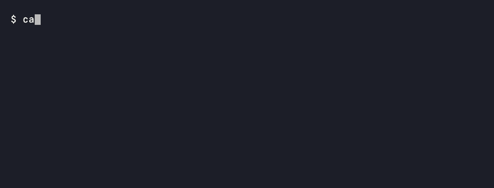
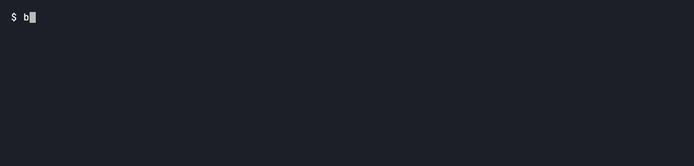

# gonf

<p align="center">
  
</p>

[](https://pkg.go.dev/github.com/efuturetoday/gonf) [](https://github.com/efuturetoday/gonf/actions) [](https://go.dev/) [](./LICENSE)

gonf is configuration for Go services. You describe your settings in a
struct, and gonf fills it from files, `.env`, the environment and flags,
and checks everything when the program starts.

## Features

- **All mistakes at start, at once**, with the file and line and a
  suggestion ("did you mean ...?").
- **See where a value comes from**: which file and line, or which
  environment variable, and what it replaced.
- **Environment variables just work**: `APP_DB_URL` sets `app.db.url`. A
  typo such as `APP_DB_PROT` gives a warning instead of being ignored.
- **Profiles** for dev, test and prod.
- **Secrets that never print**: they show as `****` in logs and output.
- **Values that build on each other**: `postgres://${app.db.host}/app`,
  or `${env::HOME}` to call a function.
- **Reference docs and an editor schema** generated from your structs, so
  they cannot drift.
- **Safe live reload**: a broken change keeps the running configuration.
- **Standard library only.**

## Getting started

```sh
go get github.com/efuturetoday/gonf
```

Describe your settings as a struct. `default` and `desc` are optional:

```go
type Config struct {
	Port int `default:"8080" desc:"HTTP port"`
	DB   struct {
		Host     string              `default:"localhost" desc:"database host"`
		URL      string              `desc:"connection string"`
		Password gonf.Secret[string] `default:"change-me"`
	}
}

var appConfig = gonf.NewMapping[Config]("app")
```

`gonf.NewMapping` ties the struct to the name `app`: the field `DB.URL`
becomes the key `app.db.url`. Put values in `config/app.properties`:

```properties
app.port=8000
app.db.host=db.internal
app.db.url=postgres://${app.db.host}:5432/app
```

Load the configuration and read the struct in `main.go`:

```go
func main() {
	cfg, err := boot.Load(context.Background(), boot.WithMappings(appConfig))
	if err != nil {
		log.Fatal(err)
	}

	for _, w := range cfg.Warnings() {
		log.Println("warning:", w)
	}

	c := appConfig.Get(cfg)
	fmt.Println("port:    ", c.Port)
	fmt.Println("db.url:  ", c.DB.URL)
	fmt.Println("password:", c.DB.Password)

	// go run . app.db.url
	if len(os.Args) > 1 {
		fmt.Println(cfg.Explain(os.Args[1]))
	}
}
```

The complete program is in [`examples/quickstart`](./examples/quickstart).
Run it from that directory:



```text
$ go run .
port:     8000
db.url:   postgres://db.internal:5432/app
password: ****
```

`boot.Load` found `config/app.properties` by itself. Now set a value with
an environment variable. It wins over the file:

```text
$ APP_PORT=9000 go run .
port:     9000
db.url:   postgres://db.internal:5432/app
password: ****
```

That is the whole idea: a struct, a file, and the environment on top.

## Examples

Each example below runs against the quickstart program.

### A mistake in the file

Say `config/app.properties` has a typo, `ulr` instead of `url`:

```properties
app.port=8000
app.db.host=db.internal
app.db.ulr=postgres://${app.db.host}:5432/app
```

The program stops at start and reports every problem, not only the first:



```text
$ go run .
gonf: bind "app": 2 problems:
  app.db.url: required, no value
  app.db.ulr: unknown key, did you mean app.db.url? (from file:config/app.properties:3)
```

A wrong type is caught the same way, for example `app.port=80x`:

```text
gonf: bind "app": app.port: invalid int "80x" (from file:config/app.properties:1)
```

### Where does a value come from?

The quickstart prints `cfg.Explain(key)` for a key given on the command
line:

```text
$ APP_PORT=9000 go run . app.port
app.port = 9000 (env:APP_PORT)
  overrides 8000 (file:config/app.properties:1)
  default 8080 (main.go:30)
```

The first line is the value in use and where it comes from. The lines
below show what it replaced, and the default from the struct tag. More in
[Where does a value come from?](docs/explain.md).

### Profiles

A profile is a named set of values for one environment. Add
`config/app-dev.properties`:

```properties
app.db.host=localhost
```

and start with `GONF_PROFILE=dev`:

```text
$ GONF_PROFILE=dev go run . app.db.url
port:     8000
db.url:   postgres://localhost:5432/app
password: ****
app.db.url = postgres://localhost:5432/app (file:config/app.properties:3)
```

The profile file replaced `app.db.host`, and `app.db.url`, which refers to
it, followed. More in [Profiles](docs/profiles.md).

### Secrets

`Password` is a `gonf.Secret[string]`, so it prints as `****` with `fmt`,
JSON, `slog` and in `Explain`. Your code gets the real value when it asks
for it:

```go
password := c.DB.Password.Value()
```

More in [Secrets](docs/secrets.md).

### Expressions and functions

A value can refer to another key with `${...}`, as `app.db.url` does with
`${app.db.host}`. A function takes the form `${name::argument}`. Read the
password from the environment variable `DB_PASSWORD`:

```properties
app.db.url=postgres://localhost/app
app.db.password=${env::DB_PASSWORD}
```

```text
$ DB_PASSWORD=s3cret go run . app.db.password
port:     8080
db.url:   postgres://localhost/app
password: ****
app.db.password = **** (file:config/app.properties:2, via env)
  default **** (main.go:30)
```

If `DB_PASSWORD` is not set, the start fails with a message that names the
key and the line. More in [Sources](docs/sources.md#expressions).

## Next steps

- **[Profiles](docs/profiles.md)**: `%dev.` keys, `app-dev.properties`,
  activating profiles.
- **[Structs](docs/binding.md)**: names, defaults, optional fields, lists,
  maps, validation, unknown keys, and converters for types of other
  packages.
- **[Secrets](docs/secrets.md)**: `gonf.Secret[T]`, what gets masked, and encrypted values.
- **[Where does a value come from?](docs/explain.md)**: `cfg.Explain` shows
  the winning value, its file and line, and what it overrides; `cfg.Warnings()`
  and `cfg.Sources()` show what was skipped and loaded.
- **[Configuration reference](docs/reference.md)**: generate a table of all
  keys with their environment variables, types and defaults, and a JSON
  Schema for editors.
- **[Sources and formats](docs/sources.md)**: `.properties`, JSON, YAML,
  `.env`, the environment, flags, secret directories, expressions with
  functions such as what git knows, and your own Sources.
- **[Reloading](docs/reload.md)**: `boot.Watch` keeps the configuration
  current when files change, and keeps the previous one if a change is
  invalid.

The API reference is on [pkg.go.dev](https://pkg.go.dev/github.com/efuturetoday/gonf).

More programs in [`examples/`](./examples):

- [`examples/quickstart`](./examples/quickstart): the program of this page
- [`examples/basic`](./examples/basic): Sources, profiles and expressions,
  set up by hand
- [`examples/boot`](./examples/boot): loading by convention
- [`examples/library-module`](./examples/library-module): a library that
  brings its own configuration, and a `-config-doc` flag
- [`examples/reload`](./examples/reload): a configuration that follows
  changes to its files

## gonf, viper or koanf?

All three load layered configuration. They differ in what they take care
of for you.

| | gonf | viper | koanf |
| --- | --- | --- | --- |
| Shape | typed structs, checked at start | keys read by name, `Unmarshal` into structs | you assemble providers and parsers |
| State | no global state | a global instance by default | an instance you create |
| Keys | case-sensitive | case-insensitive | case-sensitive |
| Environment | matched against your structs | derived by `AutomaticEnv` and `BindEnv` | `env` provider with a transform callback |

Choose **gonf** for services that want typed structs checked at start with
all errors at once, the origin of every value (`cfg.Explain`), profiles,
secrets, environment variables matched against the structs, and docs and
a schema generated from the code. Choose **viper** for its large ecosystem
and remote providers. Choose **koanf** if you want to assemble providers
and parsers yourself with few opinions.

Coming from viper or koanf:

- A Mapping per struct (`gonf.NewMapping[Config]("app")`) replaces
  `Unmarshal`. Unknown keys and missing values fail at start.
- Environment names come from the keys (`app.db.url` is `APP_DB_URL`), so
  there is nothing to bind or transform.
- Values may refer to others and call functions: `${app.db.host}`,
  `${env::HOME}`.

## Contributing

Issues and pull requests are welcome. Before sending a change, run:

```sh
go vet ./...
go test -race ./...
golangci-lint run
```

`format/yaml` and `cmd/gonf` are modules of their own; run the same
commands in their directories.

Pull requests are squashed into one commit named by their title, which
follows [Conventional Commits](https://www.conventionalcommits.org/), such
as `feat(source): Verbatim` or `fix: profile of a reload`. Releases and the
[changelog](CHANGELOG.md) are made from these titles. Report
vulnerabilities as described in [SECURITY.md](SECURITY.md).

## License

[Apache License 2.0](./LICENSE)

The gonf logo is based on the Go gopher by [Renée French](https://reneefrench.blogspot.com/),
licensed under [CC BY 4.0](https://creativecommons.org/licenses/by/4.0/).
